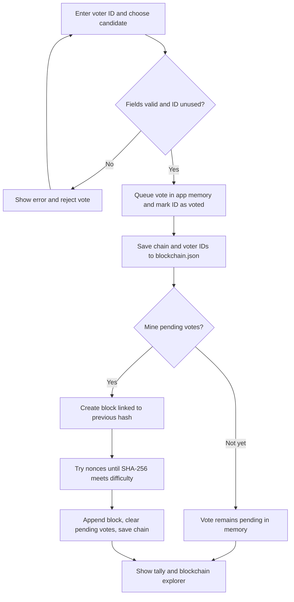

# SecureVote: Blockchain Voting Demonstration

## Project Summary

SecureVote is a small, browser-based voting demonstration built with Python and Streamlit. It shows how a sequence of vote records can be grouped into blocks, linked with cryptographic hashes, and checked for changes. Users can submit a vote, mine pending votes into a block, view a tally, and inspect the chain.

This project is intended for learning and demonstrations. It is not a production election system: it has no verified voter registration, anonymous ballot handling, distributed network, or independent election auditing.

## Purpose and Scope

The project illustrates a basic electronic voting workflow and introduces blockchain concepts such as blocks, previous-hash links, SHA-256, and proof of work. It provides a simple interface for exploring how these mechanisms affect vote recording and tamper detection.

The application is a single-process prototype. Its chain is stored in a local `blockchain.json` file; it is not replicated across independent computers or governed by a consensus network.

## Working Structure

The project is organized into a small interface layer, a voting/blockchain logic layer, and a local data file:

| File | Responsibility |
| --- | --- |
| `app.py` | Builds the Streamlit interface, collects voter ID and candidate selections, calls the blockchain operations, and displays results and blocks. |
| `blockchain.py` | Defines `Block` and `VotingBlockchain`; handles vote checks, SHA-256 hashing, proof-of-work mining, chain validation, result counting, and JSON persistence. |
| `blockchain.json` | Stores the mined chain and IDs already marked as voted. Pending votes are kept in application memory and are not stored in this file. |
| `requirements.txt` | Lists the external Python packages needed to run the application. |

### Component Flow



**At a glance:** `app.py` provides the interface, `blockchain.py` handles vote checks and mining, and `blockchain.json` stores the chain and voter IDs. Pending votes stay in memory until mined, so they are lost if the app stops first; the voter IDs may remain saved.

## How It Works

1. The voter enters a voter ID and selects a candidate in the Streamlit interface.
2. The application checks that both fields are present and that the ID has not already been recorded as having voted.
3. The vote is added to the pending-vote list. The voter ID is recorded to reject another vote using that ID.
4. A user starts mining. The application creates a block containing the pending votes and links it to the previous block's hash.
5. Proof of work repeatedly changes the block nonce until its SHA-256 hash has the configured number of leading zeroes.
6. The mined block and voter-ID list are written to `blockchain.json`. The application calculates results from mined and pending votes and provides a chain-integrity check and block explorer.

The voter ID is self-entered and is not checked against an external register. The system therefore prevents reuse of an ID in this application, but does not establish that a person is eligible to vote or stop one person from using multiple IDs.

## Technology and Language Choice

| Technology | Role in this project |
| --- | --- |
| Python | Implements the voting rules, block and chain logic, hashing, proof of work, and file persistence. |
| Streamlit | Provides the interactive web interface and session state. |
| pandas | Formats vote totals for the results table and chart. |
| Python standard library | Supplies SHA-256 (`hashlib`), JSON serialization, timestamps, and file operations. |

Python is a good fit for this learning project because the blockchain logic is concise, the standard library provides the hashing and serialization building blocks, and Streamlit makes a usable demonstration interface without requiring a separate frontend. The trade-off is that a lightweight local prototype does not provide the identity, privacy, availability, or deployment controls required for real elections.

| Alternative | Comparison with the current Python implementation |
| --- | --- |
| JavaScript with Node.js | A natural choice for a web application that needs a shared language between browser and server, or a larger real-time web stack. It would add frontend and backend architecture that this Streamlit demo does not need. |
| Java | Offers strong static typing and a mature ecosystem for larger backend services. It would require more code and setup for this small educational prototype. |

These are alternatives, not languages used by this project. Changing languages alone would not solve the prototype's security and governance limitations; those require system-level design changes.

## Intended Applications and Use Cases

- Classroom demonstrations of hash-linked blocks and proof of work.
- Small, non-binding polls in a controlled local environment.
- Prototyping and discussion of electronic voting workflows.
- Demonstrating how a changed block can cause chain validation to fail.

Do not use this application to conduct official, high-stakes, or legally binding elections.

## Advantages

- The interface makes submitting votes, checking totals, and inspecting blocks straightforward.
- Duplicate submissions using the same voter ID are rejected within the application's recorded state.
- Hash links make modifications to previously mined vote data detectable when the chain is validated.
- The code and local JSON data are easy to inspect, making the system suitable for teaching and experimentation.
- Python, Streamlit, and pandas keep the prototype relatively small and quick to run.

## Disadvantages and Security Limitations

- **No real voter authentication:** voter IDs are arbitrary text entered by users; eligibility is not verified.
- **No ballot secrecy:** mined votes include both voter IDs and candidate choices in readable JSON and are shown in the explorer.
- **Not decentralized:** one application process and one local file control the data. There are no independent nodes or distributed consensus.
- **Limited tamper resistance:** hashes can reveal inconsistent edits, but a person controlling the file and application can replace or rebuild the chain. Proof of work does not make a local file immutable.
- **Pending-vote persistence gap:** pending votes are not written to the JSON file. If the application stops before mining, those votes are lost, although their IDs may already have been saved and can remain marked as having voted.
- **No production controls:** there is no protection against concurrent writes, secure audit process, backup strategy, access control, or independent verification of election results.
- **Proof of work is only a demonstration:** mining consumes computation and does not provide a meaningful election security guarantee in this single-instance design.

These limitations mean that the project demonstrates selected blockchain ideas, not end-to-end secure or anonymous voting.

## Run the Application

Requirements: Python and the packages listed in `requirements.txt`.

```bash
pip install -r requirements.txt
streamlit run app.py
```

Streamlit prints a local address in the terminal. Open that address in a browser, submit votes, and use **Mine New Block** to add pending votes to the chain. The blockchain is stored in `blockchain.json` in the application's working directory. The reset control in the explorer deletes the stored chain and starts a new one.

## Conclusion

SecureVote is best understood as an educational prototype for exploring a voting interface, hash-linked records, and proof-of-work mining. Its simplicity makes those ideas visible, while its local storage, identifiable ballots, and lack of voter verification make it unsuitable for real elections. A production system would need a separately designed and independently reviewed approach to eligibility, ballot privacy, verifiability, threat resistance, accessibility, and election governance.